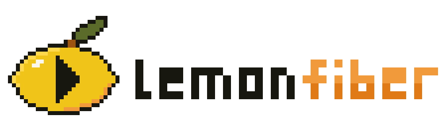

<p align="center">
  <picture>
    <source media="(prefers-color-scheme: dark)" srcset=".github/logo-on-ink.svg">
    
  </picture>
</p>

<h1 align="center">Lemonfiber &mdash; sdk-rust</h1>

<p align="center">
  <code>lemonfiber-sdk</code>: a Rust client for the web API that
  <a href="https://github.com/lemonfiber/lemonfiber">lemonfiber</a> serves. For anyone
  writing a program in Rust that reads or controls a lemonfiber media stack.
</p>

<p align="center">
  
</p>

---

It gives you every read and every action the web API serves as typed calls, the live
event stream, and errors as values. It reaches a stack on the same machine, or a stack
anywhere else whose certificate pin you hold.

**Not on crates.io.** There is no release yet; take it from GitHub at a commit.

## Requirements

- Rust 1.95 or newer, and a Tokio runtime.
- lemonfiber, serving its web API with `lemonfiber ui`.

## Install

Pin a commit from [the commit list](https://github.com/lemonfiber/sdk-rust/commits/main):

```toml
[dependencies]
lemonfiber-sdk = { git = "https://github.com/lemonfiber/sdk-rust", rev = "<commit>" }
```

## Quick start

Start lemonfiber's web API. It prints the address and a token for this run:

```console
$ lemonfiber ui --port 9000 --no-browser
lemonfiber is serving at:
  http://[::1]:9000
  http://127.0.0.1:9000
…
The token for this run, which the page will ask you for:
  <token>
```

Then ask it how the stack is doing:

```rust
use lemonfiber_sdk::contract::reads::StatusRead;
use lemonfiber_sdk::{Address, Client, Credential, Error};

#[tokio::main(flavor = "current_thread")]
async fn main() -> Result<(), Error> {
    let token = std::env::var("LEMONFIBER_TOKEN").unwrap_or_default();
    let address = Address::new("http://127.0.0.1:9000", None)?;
    let client = Client::new(address, Credential::new(token)?)?;
    let status = client.read(&StatusRead::default()).await?;
    println!("{:?} {:?}", status.data.condition, status.data.active_forms);
    Ok(())
}
```

Nothing panics for an expected failure: every call returns a `Result`, and the error's
`Display` is a sentence you can show a person.

## What it covers

- **Reads.** Every read the contract lists is a struct in `contract::reads` holding what
  it takes, answered through `Client::read` with the kind it answers with, typed. A read
  answered with a file goes through `Client::file` or `Client::picture`; the logs through
  `Client::logs`.
- **Actions.** Every action is a struct in `contract::actions` holding its arguments,
  sent with `Client::act`, or `Client::act_once` with an idempotency key. One that answers
  with a name for the work is followed with `Client::job`, `Client::follow` and
  `Client::release`.
- **Getting in.** `Door::admit` exchanges a password for a session, and
  `Door::collect_link` collects a key a key link names. Integration keys, device keys
  and the first-run setup each have their calls on `Client`.
- **What a stack can do.** `Client::capabilities`, for the credential that asked.
- **The live stream.** `Client::events` follows it, says when it broke, marks every value
  held across a gap as stale, and resumes from the last event it carried.
- **Refusals.** A refusal is read from its code where the contract lists it, and from its
  status where it does not; `contract::refusals` lists every code.

`contract` is generated from the artefact lemonfiber publishes, at the revision
`contract/VERSION` names, and never edited by hand.

[The guide](docs/guide.md) covers each of these in full.

## The address and the transport

A loopback address needs no pin. Any other address needs the stack's certificate pin,
given with it as a `CertificatePin`, and is reached over https alone, the pin checked
during the handshake. A name is accepted without a pin only where everything it
resolves to is loopback.

`Client::new` reaches the stack through `Http`, this crate's transport on `reqwest` and
`rustls`. `Client::with_transport` takes your own `Transport` for a stack on this
machine; a pinned stack is reached through `Http` alone.

## Contributing

```console
just ci        # fmt, clippy, the contract check, cargo-deny, the suite at 100% line coverage
just reads ../spec   # the reads held to the contract page, in a spec checkout
```

`contract/` is vendored with `just sync <revision>`, and the generated module rewritten
with `just generate`. Every change cites a requirement in the
[specification](https://github.com/lemonfiber/spec); start with the
[contributing guide](https://github.com/lemonfiber/spec/blob/main/50-governance/contributing.md).
Changes are listed in [CHANGELOG.md](CHANGELOG.md).

## Security

Report a vulnerability privately, as the
[security policy](https://github.com/lemonfiber/.github/blob/main/SECURITY.md)
describes. Do not open a public issue.

## Licence

[Hippocratic License 3.0](LICENSE): source-available and ethical-source, not
OSI-approved. The [licence rationale](https://github.com/lemonfiber/spec/blob/main/90-appendix/license-rationale.md)
explains what that means for you. Made by NightWorksIO.

---

<p align="center">
  <a href="https://nightworks.io">
    <picture>
      <source media="(prefers-color-scheme: dark)" srcset=".github/nightworks-white.png">
      
    </picture>
  </a>
  &nbsp;&middot;&nbsp;<a href="https://discord.nightworks.io"></a>
</p>
